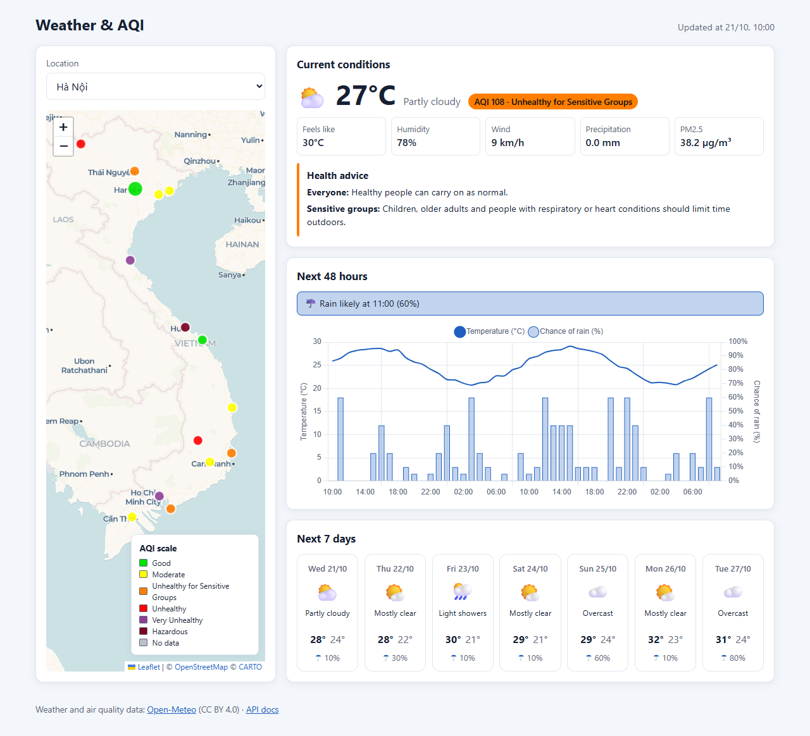
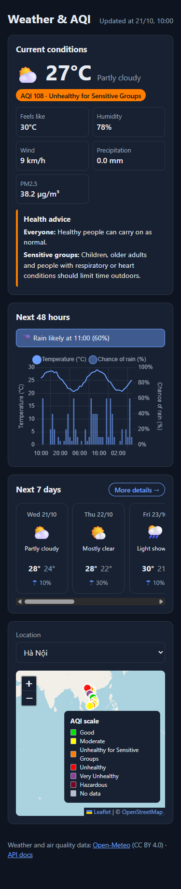

# Weather & AQI Dashboard - Group 7 (Web Design and Programming)

A web dashboard for current weather, forecasts and air quality (US EPA AQI) in 15 cities across Vietnam. All data comes from [Open-Meteo](https://open-meteo.com/); the project does not train its own models.

## Features

- **Map** of the 15 cities (Leaflet / OpenStreetMap) with markers coloured by the current AQI category.
- **Current conditions** for the selected city, plus AQI health advice for the general population and for sensitive groups.
- **48-hour chart** of temperature and chance of rain (Chart.js), with a **rain alert** banner based on the next 12 hours.
- **7-day forecast** cards.
- **Remembered location:** the last selected city is stored in the browser, and `?city=<id>` in the URL opens a specific city (deep link).
- **Auto refresh** of the current-conditions card and the map markers every 10 minutes.
- **Resilient loading:** skeleton placeholders while loading, a request timeout, and a retry button when loading data fails.
- **Mock mode:** add `?mock=1` to the URL to run the frontend on static JSON files, without the weather data source.

## Screenshots

Actual browser captures of the frontend with the bundled mock data (`?mock=1&city=1`), not live weather. Desktop viewport: **1280 × 900**; mobile viewport: **375 × 900**, captured at full page height.



The desktop dashboard places the city picker and AQI map beside current conditions, the 48-hour chart and the seven-day forecast. The current card includes advice for sensitive groups.



At 375px, the weather panels appear above the city picker and map. The seven-day forecast scrolls horizontally within its panel.

See [section 3.2: interface screenshots](environmental-system/docs/UI_Screenshots.md) for all 11 captures, including the map, current/AQI advice, 48-hour chart, seven-day forecast, rain alert, error/Retry and desktop/mobile dark mode, with captions and reproduction instructions.

The captures include the geographic basemap and AQI markers. When OpenStreetMap tiles are unavailable, the application uses CARTO Voyager with the project's browser basemap key.

## Architecture

```text
+---------------------------------------------------------------+
|        Frontend (plain HTML/CSS/JS, ES modules, no build)     |
|  - Leaflet map, markers coloured by AQI category              |
|  - Current card, 48 h Chart.js chart, 7-day forecast          |
+---------------------------------------------------------------+
                               |
                               | HTTP GET (JSON, same origin)
                               v
+---------------------------------------------------------------+
|                         FastAPI backend                       |
|  Routers:                                                     |
|    GET /api/health                                            |
|    GET /api/locations                                         |
|    GET /api/locations/{id}                                    |
|    GET /api/locations/{id}/current                            |
|    GET /api/locations/{id}/forecast                           |
|    GET /api/current   (summary of all cities, for the map)    |
|                                                               |
|  In-memory TTL cache (15 minutes, thread-safe)                |
|  SQLite (location metadata for the 15 cities)                 |
+---------------------------------------------------------------+
                               |
            +------------------+------------------+
            | cache hit                           | cache miss
            v                                     v
   [ In-memory TTL cache ]              +-----------------------+
                                        |    Open-Meteo APIs    |
                                        |  - Weather forecast   |
                                        |  - Air quality        |
                                        +-----------------------+
```

The backend also serves the static frontend, so the app runs from a single process on one origin.

## Quick start

Requires Python 3.12 or newer (and Node.js 21+ for the frontend tests, which use glob support in `node --test`). Run everything from the `environmental-system` folder.

Windows (PowerShell):

```powershell
cd environmental-system
python -m venv .venv
.venv\Scripts\Activate.ps1
pip install -r requirements.txt
uvicorn app.main:app --reload
```

macOS / Linux (bash):

```bash
cd environmental-system
python -m venv .venv
source .venv/bin/activate
pip install -r requirements.txt
uvicorn app.main:app --reload
```

Then open:

- Web app: http://127.0.0.1:8000
- Mock mode: http://127.0.0.1:8000/?mock=1
- Interactive API docs (Swagger UI): http://127.0.0.1:8000/docs

The SQLite database (`weather.db`) and the 15 default locations are created automatically on first start. No API key is needed. See [`environmental-system/README.md`](environmental-system/README.md) for configuration.

## Testing

Run from `environmental-system` with the virtual environment active. Neither suite needs network access.

```bash
# Backend (pytest, in-memory SQLite and a fake weather service)
pytest

# Frontend unit tests (Node's built-in test runner)
node --test frontend/tests/*.test.mjs
```

## Project structure

```text
.
├── README.md                      # this file
└── environmental-system/
    ├── README.md                  # developer guide
    ├── CONTRIBUTING.md            # team workflow
    ├── requirements.txt
    ├── .env.example               # optional configuration template
    ├── app/                       # FastAPI backend (routers, services, models, config)
    ├── frontend/                  # static frontend (index.html, css/, js/, mock/, tests/)
    ├── tests/                     # backend tests
    ├── collector/                 # phase 2 placeholder (not implemented)
    ├── scripts/                   # check_open_meteo.py (checks the real upstream API)
    └── docs/
        ├── API.md                 # API contract
        ├── issues/                # per-role task descriptions
        └── plans/                 # design and implementation plans
```

## Team members (Group 7)

1. Member 1: _[Full name - student ID]_
2. Member 2: _[Full name - student ID]_
3. Member 3: _[Full name - student ID]_
4. Member 4: _[Full name - student ID]_


