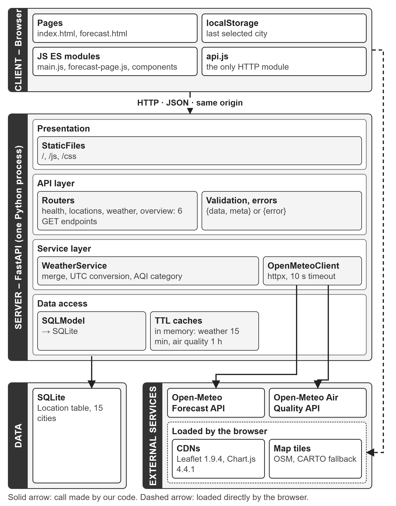
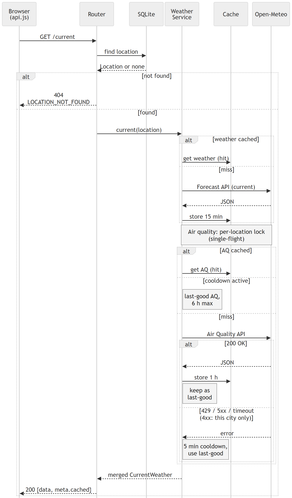

# Weather & AQI - developer guide

Backend and frontend of the Group 7 weather and air-quality dashboard for 15 Vietnamese cities. For a project overview see the [root README](../README.md).

- Backend: **FastAPI** + SQLModel + SQLite, with in-memory caches (15 minutes for weather, 1 hour for air quality).
- Frontend: plain HTML/CSS/JS (ES modules) + Leaflet + Chart.js, served by FastAPI from the same origin.
- Data: [Open-Meteo](https://open-meteo.com/) forecast and air-quality APIs (no API key).
- API contract: [`docs/API.md`](docs/API.md).

## Setup

Requires Python 3.12 or newer (and Node.js 21+ for the frontend tests, which use glob support in `node --test`). Run all commands from this folder (`environmental-system`).

```powershell
python -m venv .venv
.venv\Scripts\Activate.ps1          # macOS/Linux: source .venv/bin/activate
pip install -r requirements.txt
```

Optional: copy the configuration template.

```powershell
copy .env.example .env              # macOS/Linux: cp .env.example .env
```

Every variable has a default in `app/config.py`, so the app runs without a `.env` file. `.env` is git-ignored.

### Configuration

Values are read from environment variables or `.env` (names are case-insensitive).

| Variable | Default | Meaning |
|---|---|---|
| `DATABASE_URL` | `sqlite:///<project>/weather.db` | SQLAlchemy URL of the database. By default a SQLite file next to the code. |
| `CACHE_TTL_SECONDS` | `900` | Lifetime of cached Open-Meteo results, in seconds. |
| `AIR_QUALITY_CACHE_TTL_SECONDS` | `3600` | Lifetime of cached air-quality data per location (shared by current and forecast), in seconds. |
| `AIR_QUALITY_STALE_MAX_SECONDS` | `21600` | Maximum age of last-good air-quality data that is still served when Open-Meteo fails. |
| `AIR_QUALITY_FAILURE_COOLDOWN_SECONDS` | `300` | After an air-quality failure (e.g. 429), no air-quality requests are made for this long (all locations). |
| `AIR_QUALITY_FORECAST_DAYS` | `5` | Days requested from the air-quality API (CAMS covers about 5 days). |
| `HTTP_TIMEOUT_SECONDS` | `10` | Timeout of each request to Open-Meteo, in seconds. |
| `FORECAST_TIMEZONE` | `Asia/Ho_Chi_Minh` | IANA time zone for the forecast's daily aggregation (`daily[].date`, min/max, sums). API datetimes stay UTC. |
| `OVERVIEW_MAX_WORKERS` | `8` | Parallel workers used by `/api/current` (all cities). |
| `LOG_LEVEL` | `INFO` | Python logging level. |
| `CORS_ORIGINS` | `[]` | JSON list of allowed origins, e.g. `["http://localhost:5500","http://127.0.0.1:5500"]`. Only needed when the frontend is served from another port (such as VS Code Live Server); the default same-origin setup does not need it. Only `GET` is allowed. |

`app/config.py` also defines `OPEN_METEO_FORECAST_URL`, `OPEN_METEO_AIR_QUALITY_URL` and `OVERVIEW_MAX_WORKERS` (default `8`, the number of parallel workers used by `/api/current`). They are not listed in `.env.example`, but can be overridden the same way.

If you serve the frontend separately, also set `API_BASE` in `frontend/js/config.js` to the backend URL (for example `http://127.0.0.1:8000`).

## Run

```powershell
uvicorn app.main:app --reload
```

| URL | Content |
|---|---|
| http://127.0.0.1:8000/ | Web app |
| http://127.0.0.1:8000/?mock=1 | Web app on the static data in `frontend/mock/*.json` (always location id 1 for the detail views) |
| http://127.0.0.1:8000/docs | Swagger UI |
| http://127.0.0.1:8000/api/health | Health check: database status, app version, number of live cache entries |

On startup the app creates the tables and seeds the 15 locations (idempotent, matched by `slug`), so the first run needs no manual database step. `fastapi dev app/main.py` (from `fastapi[standard]`) works as well.

## Tests

```powershell
pytest                                       # backend
node --test frontend/tests/*.test.mjs        # frontend logic (Node's built-in runner)

```

Backend tests use an in-memory SQLite database and a fake weather service (`tests/conftest.py`). They need no network and do not touch `weather.db`. To check the real Open-Meteo API manually, run `python -m scripts.check_open_meteo` (optionally followed by a location slug such as `ha-noi`).

## Folder layout

```text
environmental-system/
├── app/
│   ├── main.py            # assembles the app: routers, error handlers, optional CORS, frontend mount
│   ├── config.py          # settings (environment / .env)
│   ├── database.py        # SQLite engine (WAL), get_session / SessionDep
│   ├── models.py          # DB tables (Location; Reading is commented out for phase 2)
│   ├── schemas.py         # API contract: Envelope, CurrentWeather, CurrentSummary, Forecast, ...
│   ├── errors.py          # AppError and handlers -> one error format
│   ├── seed.py            # the 15 locations
│   ├── routers/           # locations, overview, weather, health, shared deps
│   └── services/
│       ├── open_meteo.py  # HTTP client for Open-Meteo
│       ├── weather.py     # builds API schemas from Open-Meteo data; caching
│       ├── cache.py       # thread-safe TTL cache
│       └── aqi.py         # AQI category from the US AQI value
├── frontend/
│   ├── index.html         # dashboard
│   ├── forecast.html      # per-day forecast page (forecast-page.js)
│   ├── css/               # style.css, map.css, forecast.css, forecast-page.css
│   ├── js/                # main.js (orchestration), api.js (only module that calls the API,
│   │                      #   incl. mock mode and timeout), config.js, rain-alert.js,
│   │                      #   location-memory.js, health.js, forecast-page.js, day-detail.js,
│   │                      #   day-summary-text.js, uv-index.js, page-links.js, ...
│   │                      #   and components/ (day-bar, day-view, day-charts, hour-icons, ...)
│   ├── mock/              # sample responses matching the API contract
│   └── tests/             # node --test unit tests
├── tests/                 # backend tests
├── collector/             # phase 2 placeholder (not implemented)
├── scripts/               # check_open_meteo.py
├── docs/                  # API.md, Architecture.md, Design_Description.md, ER_Diagram_Explanation.md,
│                          #   UI_Screenshots.md, test-catalog.md, diagrams/ (Mermaid),
│                          #   wireframes/ (HTML), test-output/, images/, issues/, plans/
├── requirements.txt
├── requirements-dev.txt   # + pytest-cov (coverage, optional)
├── pytest.ini
└── .env.example
```

## Architecture



_Figure 1. Layered system architecture._



_Figure 2. Request sequence for the current-weather endpoint._

The system follows a client-server architecture. The frontend,
running in the user's web browser, communicates with the FastAPI
backend through REST API endpoints (/api/...).

The FastAPI backend routes incoming requests to WeatherService,
which handles business logic and retrieves weather and air quality
data. WeatherService uses in-memory TTLCaches (15 minutes for weather,
1 hour for air quality) to reduce repeated external API requests.

When cached data is unavailable or expired, WeatherService
retrieves forecast and air quality data from Open-Meteo, a
third-party weather data provider.

SQLite stores location metadata, while Leaflet and Chart.js
are loaded through external CDNs. OpenStreetMap provides map tiles
for the interactive map.

The numbered arrows in Figure 1 illustrate the request and
response sequence between the main components.

## Endpoints

All endpoints are `GET`. Successful responses are `{ "data": ..., "meta": ... }`; errors are `{ "error": { "code", "message" } }`. Details are in [`docs/API.md`](docs/API.md).

| Endpoint | Purpose |
|---|---|
| `/api/health` | Database and cache status |
| `/api/locations` | List of locations (optional `region=north\|central\|south`) |
| `/api/locations/{id}` | One location |
| `/api/locations/{id}/current` | Current weather and AQI |
| `/api/locations/{id}/forecast?hours=48&days=7` | Hourly and daily forecast |
| `/api/current` | Summary of all locations, used to colour the map markers |

## Data flow and caching

1. The router validates the request and resolves the location from SQLite (unknown id -> 404).
2. `WeatherService` (`app/services/weather.py`) looks in the in-memory `TTLCache`. On a miss it calls the Open-Meteo forecast API and air-quality API and maps the result to the project's schemas.
3. The cache key is per location and kind (`current` or `forecast`), with a TTL of `CACHE_TTL_SECONDS` (15 minutes); it holds only the weather part. Air quality is cached separately per location (`AIR_QUALITY_CACHE_TTL_SECONDS`, 1 hour) and merged when responding, so current and forecast share one air-quality request. The caches live in the process, so each uvicorn worker has its own. A forecast-API failure stores nothing; an air-quality failure is never cached either: it starts a cooldown (`AIR_QUALITY_FAILURE_COOLDOWN_SECONDS`) during which no air-quality request is made, and the last good air-quality data (up to `AIR_QUALITY_STALE_MAX_SECONDS` old) is served instead, or null AQI fields if there is none.
4. `meta.cached` is true only when no request to Open-Meteo was made: weather came from the cache and air quality came from its cache, last-good data or a cooldown skip.

Rules worth knowing:

- **One forecast per location is cached**, always covering the maximum range (7 days / 168 hours). `hours` (1-168, default 48) and `days` (1-7, default 7) only trim the cached copy when responding, so every parameter combination shares one cache entry.
- **Hourly data is filtered at serve time:** only points at or after the current UTC hour are returned, so an older cached forecast does not start in the past.
- **AQI is optional.** If the air-quality API fails (and no recent last-good data exists), weather is still returned and all AQI fields (`pm2_5`, `us_aqi`, `aqi_category`) are `null`. The same happens for hours beyond the range of the air-quality data. If the weather API fails, the endpoint returns 502/503.
- **Any air-quality failure, even a single timeout, pauses air-quality requests for all cities for `AIR_QUALITY_FAILURE_COOLDOWN_SECONDS`** (Open-Meteo limits per IP). The cooldown is per process. A 4xx other than 429 is logged as an error and only backs off that one location for the same duration.
- **Current AQI** is the hourly air-quality value for the current UTC hour; the payload's `current` block is only a fallback when that hour is missing and the data is fresh.
- The `WeatherService` singleton (and so its caches) is created once per process, guarded by a lock against concurrent first requests.
- **Missing values are `null`**, never `0`. Air-quality and weather hours are joined by timestamp, not by index.
- **Datetimes are UTC; daily values are local days.** The forecast is requested with `timezone=FORECAST_TIMEZONE` (default `Asia/Ho_Chi_Minh`), so `daily[].date`, min/max and sums are Vietnam calendar days; hourly and current times are converted back to UTC using `utc_offset_seconds`. Air quality is requested in GMT. The frontend converts times to Vietnam time for display.
- **AQI categories are decided by the backend** (`app/services/aqi.py`, US EPA scale from the `us_aqi` value). The frontend only displays them.
- **`/api/current`** fetches all locations in parallel and skips locations that fail. It returns an error only when every location fails.

## Frontend notes

- `js/api.js` is the only module that makes requests. `?mock=1` makes it read `frontend/mock/*.json` instead.
- The current card and the map markers refresh every 10 minutes (`REFRESH_MINUTES` in `js/config.js`), skipped while the tab is hidden. Requests time out after 25 s (`REQUEST_TIMEOUT_MS`).
- The selected location is stored in `localStorage` and mirrored to `?city=<id>`; the URL value wins on load, then the stored one, then the first location.
- The rain alert looks at the next 12 hours of the hourly forecast (chance of rain of at least 60 % or a rain/thunderstorm weather code).

## Known limitations

- **The cache is per process.** Each uvicorn worker has its own copy.
- **No single-flight on a cold weather cache.** Concurrent requests for the same uncached location each call the Open-Meteo forecast API. This applies to the weather cache only; air quality is single-flight per location (concurrent requests share one air-quality call).

## Not implemented yet

Phase 2 (periodic collector, history, anomaly detection) is a placeholder: `collector/run.py` and the commented-out `Reading` model.
