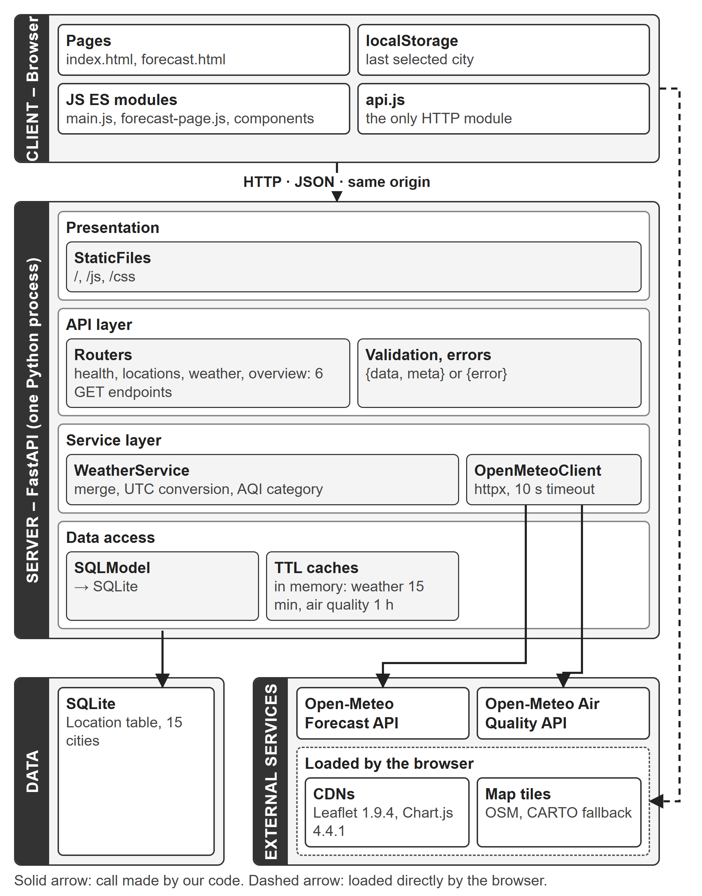
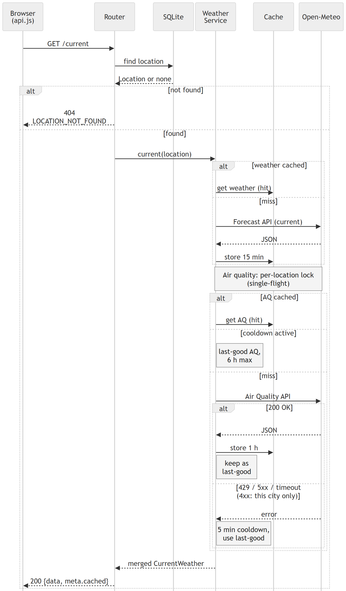

# 2.3 System architecture

**Figure 3a caption:** Layered architecture of the Weather & AQI dashboard (client, FastAPI server, data and external services).

**Figure 3b caption:** Sequence of `GET /api/locations/{id}/current`, including the caches, the air-quality cooldown and the last-good fallback.

Sources: [`diagrams/system-architecture.html`](diagrams/system-architecture.html) (hand-made HTML/CSS, Figure 3a) and [`diagrams/request-sequence.mmd`](diagrams/request-sequence.mmd) (Mermaid, Figure 3b).

To re-render, from `environmental-system`:
- Figure 3a: `chrome --headless=new --screenshot=docs/images/system-architecture.png --window-size=1000,1275 --force-device-scale-factor=2 --hide-scrollbars file:///<path>/docs/diagrams/system-architecture.html`
- Figure 3b: `npx -y @mermaid-js/mermaid-cli@11.4.2 -i docs/diagrams/request-sequence.mmd -o docs/images/request-sequence.png -w 1600 -s 2 -b white`

## Layers (Figure 3a)

- **Client (browser):** `index.html` and `forecast.html`, JavaScript ES modules (`main.js`, `forecast-page.js` and the components), `api.js` as the only HTTP module, and `localStorage` for the last selected city.
- **Server (FastAPI, one Python process):**
  - Presentation: `StaticFiles` serves `/`, `/js` and `/css`.
  - API layer: routers (health, locations, weather, overview) with 6 GET endpoints, input validation and error handlers returning `{data, meta}` or `{error}`.
  - Service layer: `WeatherService` (merge, UTC conversion, AQI category) and `OpenMeteoClient` (httpx, 10 s timeout).
  - Data access: SQLModel on SQLite, and in-memory TTL caches (weather 15 minutes, air quality 1 hour).
- **Data:** SQLite with the `Location` table (15 cities).
- **External services:** Open-Meteo Forecast API and Air Quality API (called by `OpenMeteoClient`), and the CDNs (Leaflet 1.9.4, Chart.js 4.4.1) and map tiles (OpenStreetMap, CARTO fallback), which the browser loads directly.

## Client–server model

The application is a classic client–server web app deployed as **one service**. A single FastAPI process serves both the static frontend (`/`, `/forecast.html`, `/js`, `/css`) and a read-only JSON REST API under `/api`. There is no separate frontend host and no build step.

- **Client (browser):** two pages written in plain HTML, CSS and JavaScript ES modules.
  - `index.html` is the dashboard: city picker, Leaflet map with AQI-coloured markers, current conditions with AQI health advice, a 48-hour Chart.js chart and seven day cards.
  - `forecast.html` is the per-day forecast page. It opens in the same tab from a day card or the "More details" link (`?city=<id>&day=<YYYY-MM-DD>`) and shows a day bar, a summary, and temperature, rain, humidity and wind, UV and AQI charts.
  - `api.js` is the only module that calls the backend. The last selected city is kept in `localStorage`.
  - Leaflet, Chart.js and the map tiles are loaded from public CDNs.
- **Server (FastAPI, Python 3.12):** routers validate input and return `{data, meta}` or `{error: {code, message}}`.
  - The SQLite database holds only the `Location` table (15 cities, seeded at start-up).
  - `WeatherService` merges, normalises and caches weather and air-quality data.
  - `OpenMeteoClient` (httpx, 10 s timeout) is the only component that talks to the outside world.
- **Third-party data source: Open-Meteo.** No API key is needed. All weather and air-quality values come from Open-Meteo; the application does not measure or model anything itself. Its added value is aggregation, caching, normalisation (UTC datetimes, missing values kept as `null`), AQI classification and visualisation.

## Request flow (Figure 3b)

The sequence is for `GET /api/locations/{id}/current`; `/forecast` follows the same steps with the forecast variables.

1. The browser's `api.js` sends the request. The router looks up the location in SQLite through a dependency before the service is called; an unknown id returns `404 LOCATION_NOT_FOUND`.
2. The router calls `WeatherService.current(location)`.
3. Weather is looked up first. On a miss, `OpenMeteoClient` calls the Forecast API (current variables, `Asia/Ho_Chi_Minh`) and the result is stored for 15 minutes. If the forecast call fails, the API returns 502 or 503 and nothing is stored.
4. Air quality is handled after weather, in the same request (the two steps run one after the other).
   - Cache hit (1 hour): the cached data is used.
   - Cooldown active (global, 5 minutes after a failure, or per location after a 4xx other than 429): no call is made and the last-good data (up to 6 hours old) is used, or empty AQI.
   - Miss: the Air Quality API is called (`pm2_5`, `us_aqi`, 5 days, GMT). On success the data is stored for 1 hour. On HTTP 429, 5xx, a timeout or an unusable reply, nothing is cached, the cooldown starts and the last-good data is used.
   - The last-good data and the cooldown are state of `WeatherService` itself, not entries of the TTL cache.
   - A lock per location makes this single-flight: concurrent requests for the same location wait and reuse the cache.
5. The service merges weather and air quality (local times converted to UTC with `utc_offset_seconds`, AQI joined by timestamp, AQI category added). The router returns `{data, meta}`, where `meta.cached` is true only when no call to Open-Meteo was made. The frontend converts UTC to Vietnam time for display.

Forecast variables: current conditions use 8 variables; hourly and daily data use 16 variables over 8 days (so daily values are Vietnam calendar days).

## Design notes and trade-offs

- **One service instance per process.** The `WeatherService` singleton (and so its caches) is created once per process, guarded by a lock against concurrent first requests.
- **Cache instead of a weather table.** Weather data changes continuously and Open-Meteo already stores the source data. The in-memory caches (15 minutes for weather, 1 hour for air quality, which also falls back to the last good data when Open-Meteo rate-limits us) cut upstream calls and keeps the database small.
  - The cache is lost on restart.
  - Each process has its own cache.
  - No history is kept. A `Reading` table is planned for Phase 2 and is not implemented.
- **Split forecast requests.** Open-Meteo counts a request with more than 10 variables as several calls, so current conditions and hourly+daily data are requested separately. This uses less quota than one 24-variable request.
- **Shared quota.** The Open-Meteo free limit is per IP address. On a shared host such as Render, the air-quality quota can run out and the UI then shows "No data" for AQI. This is a known limitation.
