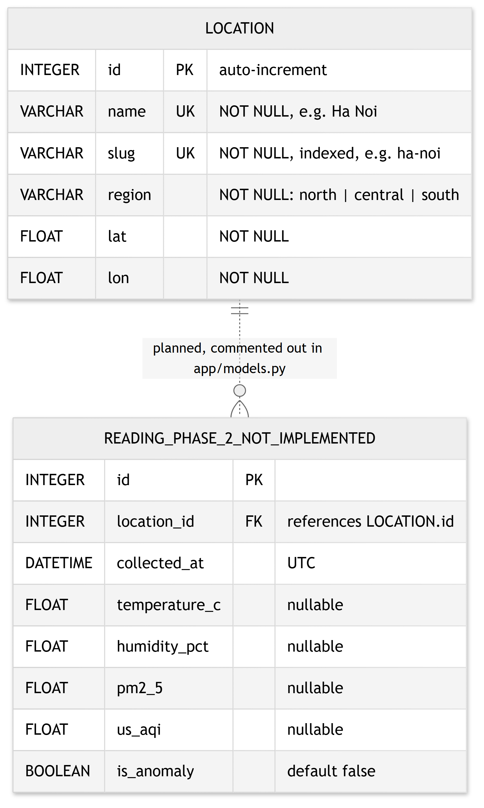

# 2.4 Database design – ER diagram

**Figure caption:** Entity-Relationship diagram of the SQLite database (`Location` implemented; `Reading` planned for Phase 2).

Source: [`diagrams/er-diagram.mmd`](diagrams/er-diagram.mmd) (Mermaid, neutral theme, readable in black and white).

The SQLite database contains **one implemented table**, `Location`, defined in `app/models.py` and seeded with 15 Vietnamese cities by `app/seed.py` at start-up.

| Column | Type | Constraints | Meaning |
|---|---|---|---|
| `id` | INTEGER | primary key | City id used in every `/api/locations/{id}/...` URL and in `?city=` |
| `name` | VARCHAR | NOT NULL, unique | Display name, e.g. "Hà Nội" |
| `slug` | VARCHAR | NOT NULL, unique, indexed | URL-friendly name, e.g. `ha-noi` |
| `region` | VARCHAR | NOT NULL | `north`, `central` or `south` (used by `?region=` filter) |
| `lat`, `lon` | FLOAT | NOT NULL | Coordinates sent to Open-Meteo and used for map markers |

**Weather and air-quality data are not stored in the database.** They come from **Open-Meteo, a third-party data provider**, and are kept by `WeatherService` in an in-memory `TTLCache` for 15 minutes (900 s). The cache keys are `("current", location_id)` and `("forecast", location_id)`. The forecast entry holds the full 168-hour / 7-day payload, including the fields added for the forecast page: feels-like temperature, humidity, wind, UV, sunrise/sunset and daily UV max. The new forecast page needed **no schema change**: all its data is derived from the cached forecast.

**Why this design.**
- Weather values change every hour.
- Open-Meteo already keeps the source data.
- The cache cuts repeated upstream calls and makes repeated requests fast.

**Trade-offs.**
- Cached values are lost when the process restarts.
- Each process or worker has its own cache.
- No historical readings are kept, so trends and anomaly detection are not possible yet.

**`Reading` (dashed relationship in the figure) is Phase 2 and not implemented.** Its model is commented out in `app/models.py`. If it is enabled, each `Location` would have zero or more `Reading` rows through `Reading.location_id`, with an index on `(location_id, collected_at)` for history queries. The planned `collector/run.py` only raises "not implemented".
