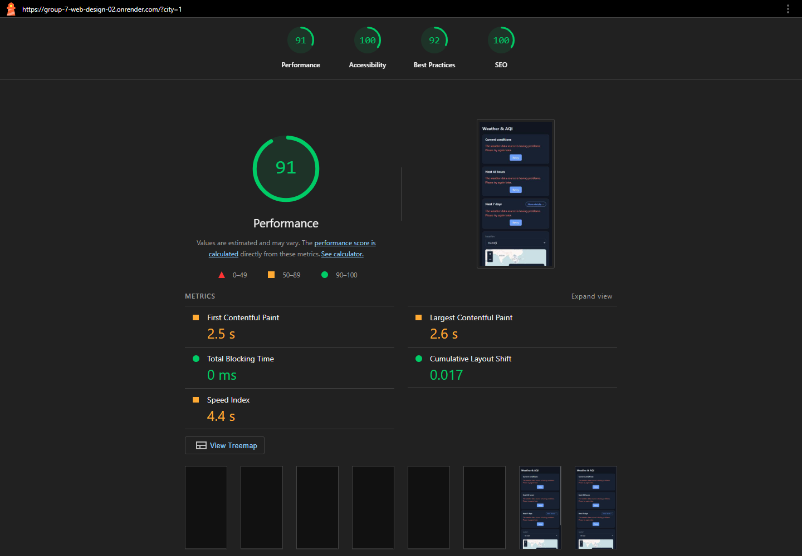
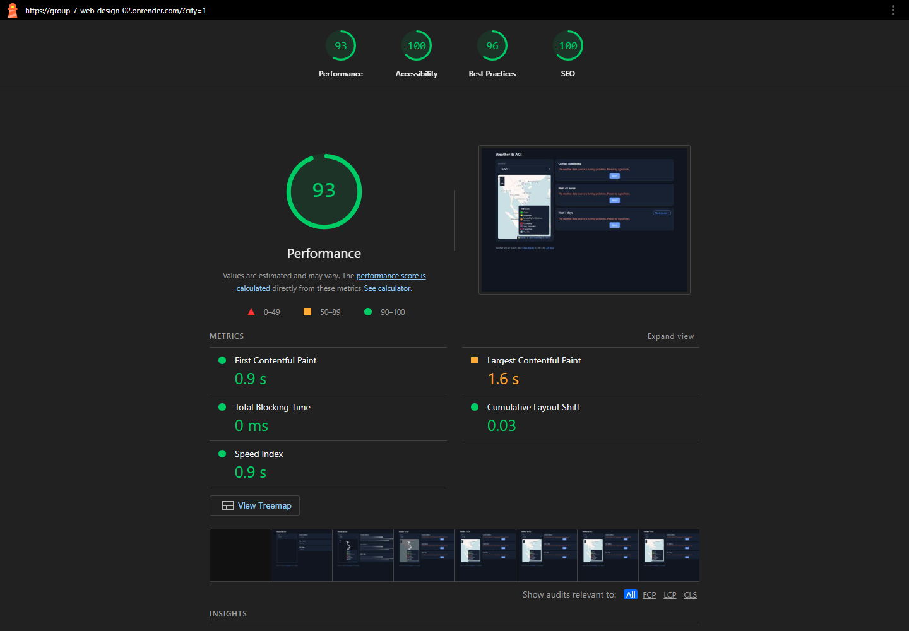

# 4.1 Lighthouse audit results

Privacy note: local filesystem paths in the failed-run error stacks and CARTO API key values in resource URLs were redacted before publication. Audit scores, timestamps, error codes and measurement data were not changed.

Audited URL: https://group-7-web-design-02.onrender.com/ (the application adds `?city=1`). These are real Lighthouse 13.6.0 navigation audits, run through the official Node CLI/API and captured from the generated Lighthouse HTML reports. No mock data, blocked requests, score edits or application changes were used.

## Scores

| Device | Performance | Accessibility | Best Practices | SEO | Audit time (Vietnam, UTC+7) |
|---|---:|---:|---:|---:|---|
| Mobile | 91 | 100 | 92 | 100 | 4 November 2026, 23:37:11 |
| Desktop | 93 | 100 | 96 | 100 | 4 November 2026, 23:36:46 |

No category is below 90 in these completed runs. The failed mobile navigation returned HTTP 503 and produced null scores; it is retained separately and is not counted as a scored result. The mobile audit was rerun because of this navigation failure, rather than to select a better score.

**Important limitation:** in both scored runs, `/api/locations/1/current`, `/api/locations/1/forecast?hours=48&days=7`, and `/api/current` returned HTTP 502. The captured page therefore shows weather error/Retry panels instead of populated weather and forecast charts. These scores describe the deployed page in that observed error state; they do not establish the performance of the complete, successfully loaded dashboard. Re-audit after resolving the upstream/API failures. A score of 100 for accessibility or SEO also covers only automated checks, not a complete manual assessment.

## Screenshots and original reports



Mobile: all four category scores and the measured page preview are visible. The preview records the actual error state returned by the deployed application.



Desktop: all four category scores are visible, together with the measured rendering metrics.

- [Mobile HTML report](lighthouse/lighthouse-mobile.html) and [raw JSON](lighthouse/lighthouse-mobile.json).
- [Desktop HTML report](lighthouse/lighthouse-desktop.html) and [raw JSON](lighthouse/lighthouse-desktop.json).
- [Failed mobile navigation: HTML](lighthouse/lighthouse-mobile-failed-503.html) and [JSON](lighthouse/lighthouse-mobile-failed-503.json).

## Findings and improvements

| Finding in the saved audits | Impact / suggested improvement |
|---|---|
| Weather API requests returned HTTP 502 on both devices | Check deployment logs and upstream Open-Meteo responses/timeouts; restore successful API responses, then repeat both audits. The browser report alone does not identify the backend root cause. |
| OpenStreetMap tile requests logged `ERR_CONNECTION_REFUSED`; the CARTO fallback loaded | Investigate tile connectivity in the target environment. Keep a functioning fallback and visible attribution; console network errors reduce Best Practices. |
| Mobile flags low-resolution map images | Use a supported high-DPI/retina tile configuration for high-density displays, while considering the additional download size. This contributes to mobile Best Practices being 92 rather than 100. |
| Render-blocking resources: estimated savings 1,380 ms mobile / 520 ms desktop | Inspect the report's resource list; defer non-critical scripts and load map/chart dependencies only when needed. Verify dependency order and chart/map behavior after any change. |
| Unused JavaScript: estimated savings 79 KiB mobile / 80 KiB desktop | Consider loading only the map/chart features needed on each page, or a smaller chart bundle. |
| Inefficient cache lifetimes: estimated savings 24 KiB | Configure suitable cache headers for versioned static assets where the hosting/CDN permits it. |

These are audit findings and proposed improvements, not fixes applied during this measurement. The page already includes a meta description; no missing-description SEO problem was reported.

## Measurement conditions

| Setting | Mobile | Desktop |
|---|---|---|
| Screen emulation | 412 × 823, DPR 1.75 | 1350 × 940, DPR 1 |
| Throttling method | Simulated | Simulated |
| RTT / throughput | 150 ms / 1,638.4 Kbps | 40 ms / 10,240 Kbps |
| CPU slowdown multiplier | 4 | 1 |
| First Contentful Paint | 2.5 s | 0.9 s |
| Largest Contentful Paint | 2.6 s | 1.6 s |
| Total Blocking Time | 0 ms | 0 ms |
| Cumulative Layout Shift | 0.017 | 0.030 |

These are laboratory measurements on the public HTTPS deployment, not real-user field data. Network conditions, hosting state and API availability affect repeatability. Full configuration, browser user agent, timestamps and audit details are preserved in JSON.

## Reproduce

On Windows with Node.js 22+ and Google Chrome installed at its standard path, from `environmental-system`:

```powershell
npm install --prefix "$env:TEMP\group7-lighthouse" lighthouse@13.6.0 --no-audit --no-fund
node scripts/audit-lighthouse.mjs
node scripts/capture-lighthouse.mjs
```

To rerun just one device, append `mobile` or `desktop` to the audit command. Reports are written to `docs/lighthouse/`; screenshots of the actual reports are written to `docs/figures/`. Running again overwrites the corresponding latest reports and screenshots; archive previous evidence before repeating.
