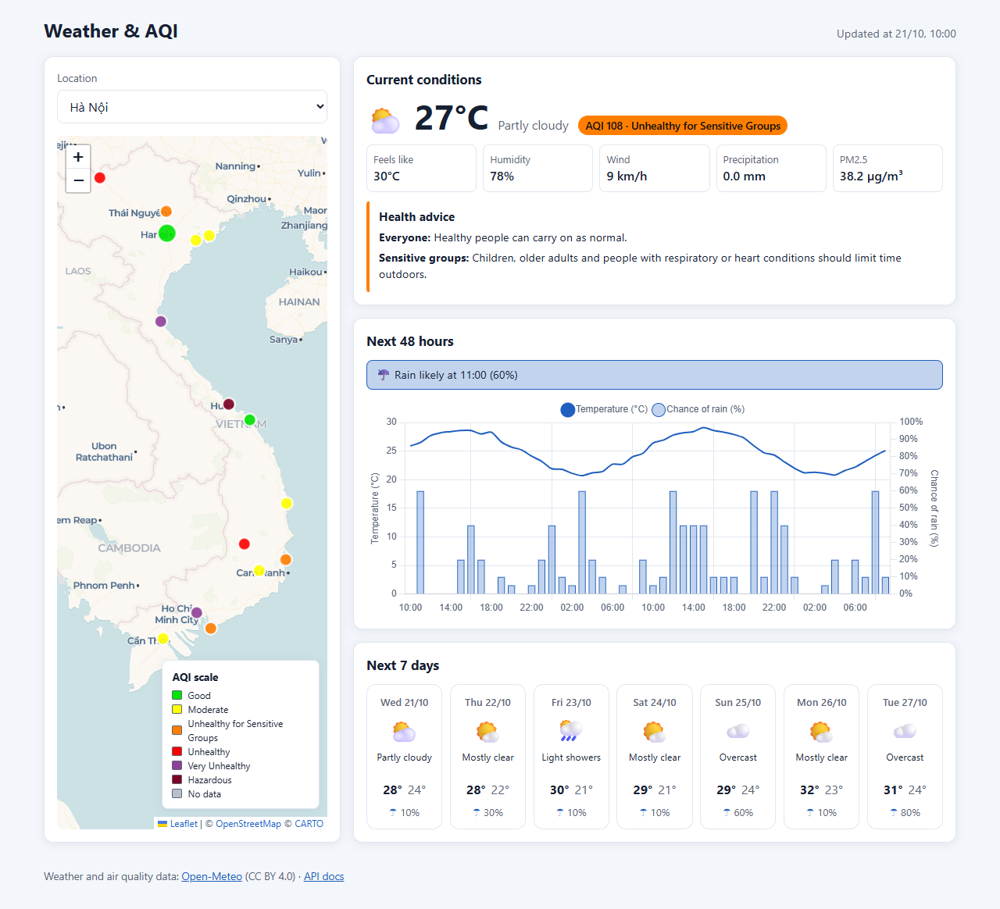
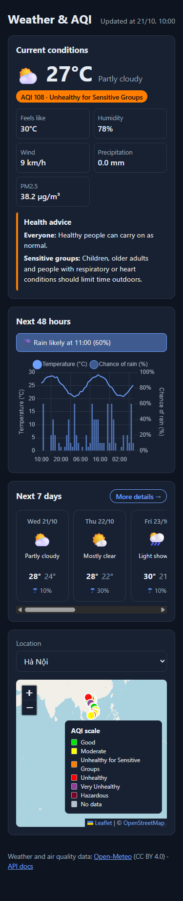
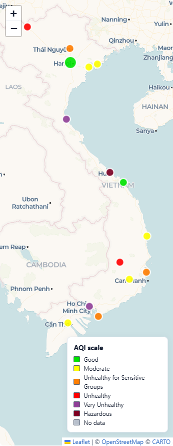
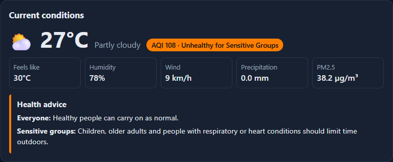
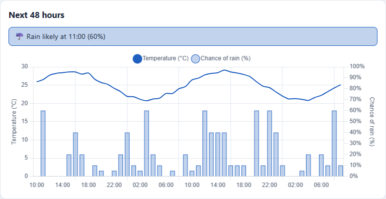
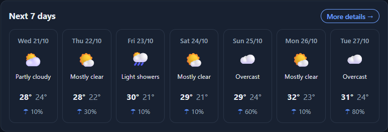
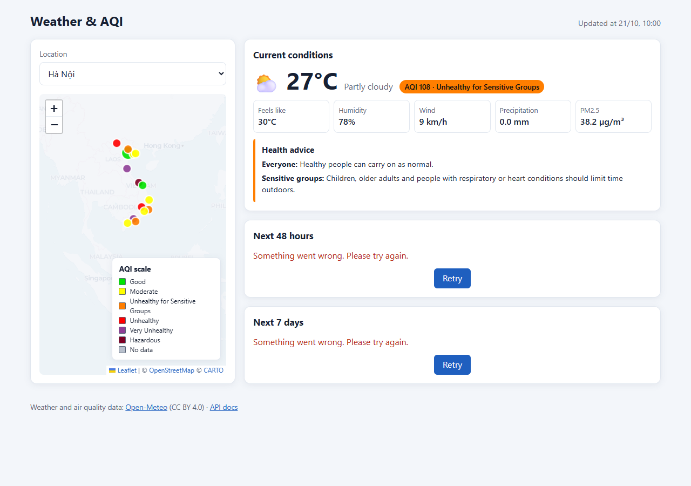
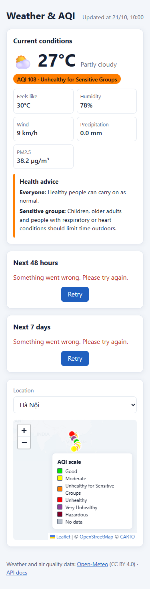
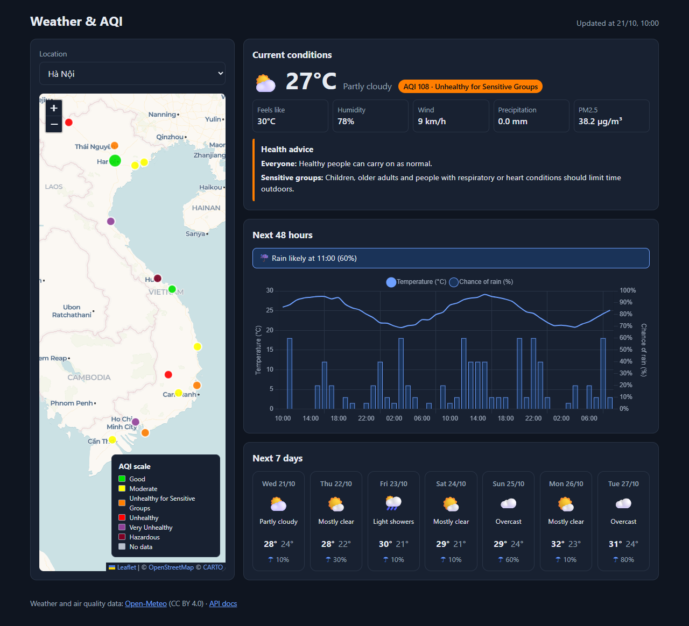
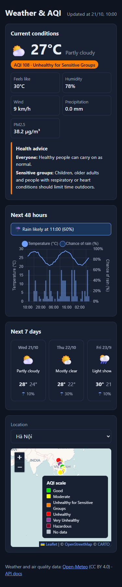

# 3.2 Interface screenshots

These are actual Chrome browser captures of the implemented frontend, taken on 3 November 2026. The page uses `?mock=1&city=1`: the bundled Hanoi sample is dated 21 October 2026 and is illustrative data, not current observations. No application components or weather values were replaced for the screenshots.

Desktop captures use a 1280 × 900 CSS-pixel viewport; mobile captures use 375 × 900. Full-page screenshots include content below the viewport. Dark mode is the existing `prefers-color-scheme: dark` stylesheet, selected through browser emulation; there is no theme toggle in the application.

The map and full-page images were recaptured after configuring the project's CARTO browser basemap key. When OpenStreetMap tiles are unavailable, the existing fallback now loads CARTO Voyager geographic imagery without the “API KEY REQUIRED” watermark. The screenshots use the application's actual external map tiles.

## Desktop overview



The full desktop page uses a two-column layout, with location selection and the map on the left. Current conditions, the 48-hour forecast and the seven-day cards are stacked on the right.

## Mobile overview — 375px



The full mobile page stacks the forecast panels above the location selector and map. All seven daily cards are present in a horizontally scrollable strip; only the cards that fit are visible in this static image.

## Map and AQI legend



The map shows city markers coloured by AQI category, zoom controls and a labelled AQI legend. CARTO Voyager provides the geographic background, with OpenStreetMap and CARTO attribution visible.

## Current conditions and AQI advice



The current card shows temperature, weather, humidity, wind, precipitation and PM2.5. Sample AQI 108 is labelled “Unhealthy for Sensitive Groups”, with separate advice for everyone and sensitive groups.

## 48-hour forecast



The chart combines hourly temperature as a line with rain probability as bars on a second axis. A conditional rain alert appears above the chart.

## Seven-day forecast



Seven cards show the day, weather condition, maximum/minimum temperature and highest rain probability. All seven fit in a single row at the desktop width.

## Rain alert


The bundled forecast triggers “Rain likely at 11:00 (60%)”. This banner is inside the 48-hour panel and is derived from the first 12 hours of forecast data.

## Error and Retry — desktop



The capture server returns HTTP 503 for the mock forecast request, exercising the application's real error handling. The hourly and daily panels show Retry while the independent current-conditions request still succeeds.

## Error and Retry — mobile



At 375px the forecast error messages and Retry buttons remain visible in the stacked panels. After this capture, restoring the response and clicking the hourly Retry button successfully reloaded both the chart and all seven daily cards.

## Dark mode — desktop



The dark preference changes the page, cards, text and chart colours using the existing CSS theme. External map imagery follows its provider rather than the application's theme.

## Dark mode — mobile



The mobile page uses the same dark theme with the responsive one-column layout. AQI category labels and health advice remain visible alongside their colours.

## Reproduce the captures

From `environmental-system`, run:

```powershell
node scripts/capture-ui.cjs
```

Requires Node.js 22+ and Google Chrome at its standard Windows installation path; set `CHROME_PATH` to override the executable. No npm dependencies or backend are needed: the script serves the existing frontend and mock JSON on `127.0.0.1:8765`, then uses an isolated headless Chrome profile and debugging port 9223. Those ports must be free. Internet access is required for the existing Leaflet/Chart.js CDN assets and external map tiles.

The script waits for rendered components, finishes chart animations, captures the full pages and component crops, checks that the mobile page has no horizontal overflow, and verifies recovery by clicking Retry after restoring the forecast response. The temporary HTTP 503 affects only the capture server; repository fixtures and application code are unchanged. The temporary Chrome profile is left in the operating-system temp directory for normal cleanup.
