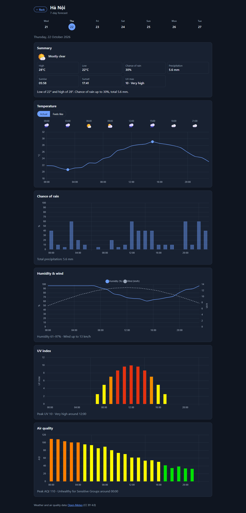
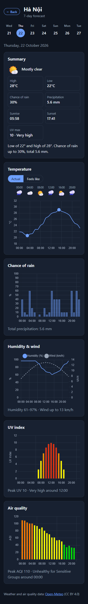
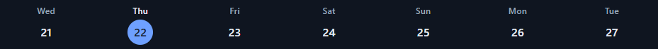
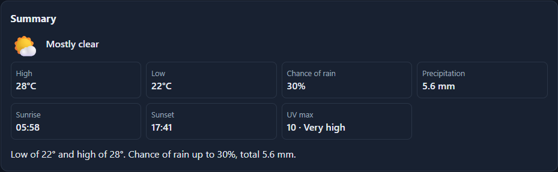
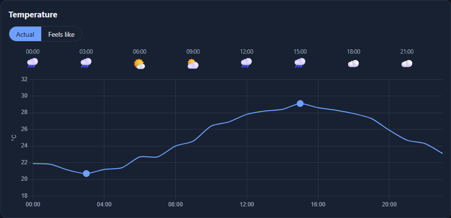
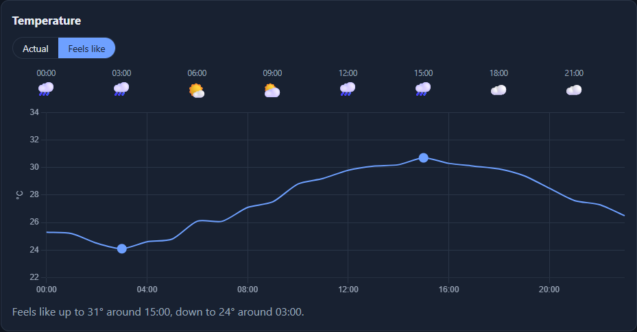
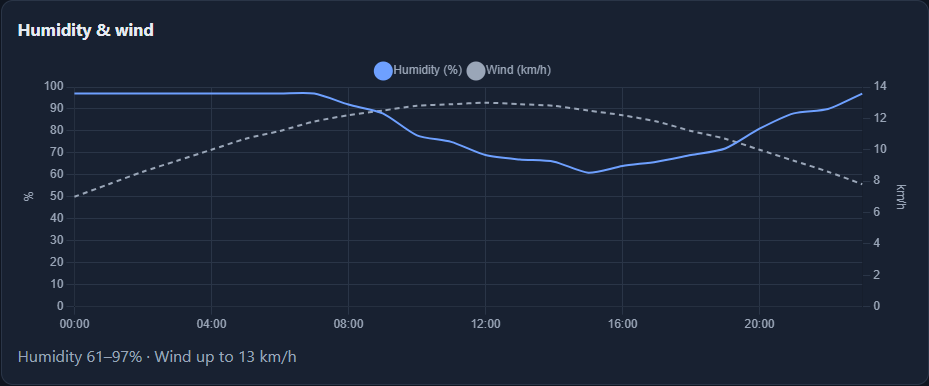
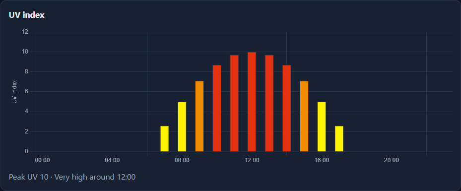
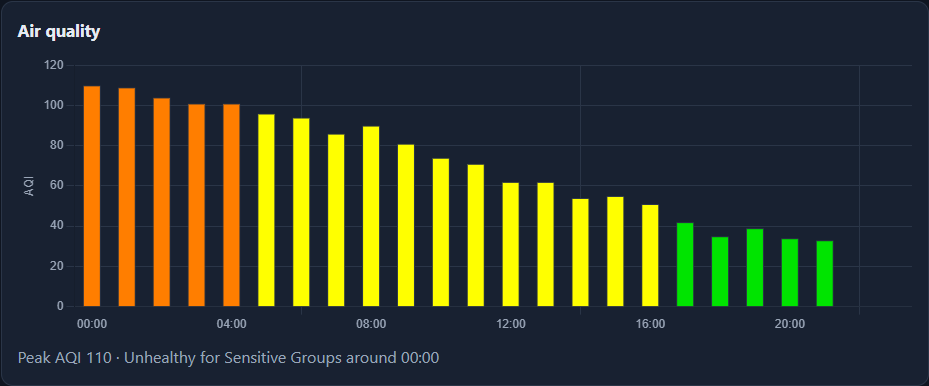

# 3.2 Interface screenshots

These are actual Chrome browser captures of the implemented frontend, taken on 4 November 2026. The pages use `?mock=1&city=1`: the bundled Hanoi sample is dated 21 October 2026 and is illustrative data, not current observations. No application components or weather values were replaced for the screenshots.

The forecast page is opened for Thursday 22 October 2026 (`day=2026-10-22`), so it shows a complete day with no partial-day note. Desktop captures use a 1280 × 900 CSS-pixel viewport; mobile captures use 375 × 900. Full-page screenshots include content below the viewport. All captures use the application's fixed dark theme; there is no theme toggle.

The map shows the application's actual external map tiles. In this capture run OpenStreetMap tiles loaded; when they are unavailable the existing fallback loads CARTO Voyager imagery, so the basemap may differ between runs.

## Desktop overview

The full desktop page uses a two-column layout, with location selection and the map on the left. Current conditions, the 48-hour forecast and the seven-day cards are stacked on the right; the seven-day panel has a “More details” link.

## Mobile overview — 375px

The full mobile page stacks the forecast panels above the location selector and map. All seven daily cards (links to the forecast page) are present in a horizontally scrollable strip; only the cards that fit are visible in this static image.

## Map and AQI legend

The map shows city markers coloured by AQI category, zoom controls and a labelled AQI legend over the geographic basemap, with tile attribution visible.

## Current conditions and AQI advice

The current card shows temperature, weather, humidity, wind, precipitation and PM2.5. Sample AQI 108 is labelled “Unhealthy for Sensitive Groups”, with separate advice for everyone and sensitive groups.

## 48-hour forecast

The chart combines hourly temperature as a line with rain probability as bars on a second axis. A conditional rain alert appears above the chart.

## Seven-day forecast

Seven cards show the day, weather condition, maximum/minimum temperature and highest rain probability. Each card is a link to that day on the forecast page, and a “More details →” link in the panel header opens the forecast page. All seven fit in a single row at the desktop width.

## Rain alert

The bundled forecast triggers “Rain likely at 11:00 (60%)”. This banner is inside the 48-hour panel and is derived from the first 12 hours of forecast data.

## Forecast page

The forecast page (`forecast.html`) opens from the “More details” link or from a day card on the home page. It shows the selected city, a day bar and six cards for the chosen day, drawn with five Chart.js charts.

### Forecast page — desktop

The full desktop page shows a Back link, the day bar, then Summary, Temperature, Chance of rain, Humidity & wind, UV index and Air quality cards stacked in one column for Thursday 22 October 2026.

### Forecast page — mobile, 375px

At 375px the same cards stack in a single column without horizontal overflow, and the Summary statistics wrap onto more rows.

### Day bar

The day bar lists the seven forecast days as tabs with weekday and date; the selected day (Thursday 22) is highlighted.

### Summary

The Summary card shows the weather condition, high and low, chance of rain, precipitation, sunrise and sunset, and maximum UV, followed by a generated one-sentence summary.

### Temperature

The Temperature card has an Actual / Feels like toggle, a row of hourly weather icons every three hours aligned above the chart, and the hourly temperature line with the highest and lowest points marked.

### Temperature — Feels like

After clicking “Feels like”, the chart switches to apparent temperature and a line below it states the highest and lowest feels-like values and their times.

### Humidity & wind

Hourly relative humidity is drawn as a solid line on the left axis and wind speed as a dashed line on the right axis, with a range summary beneath.

### UV index

Hourly UV bars are coloured by WHO category (yellow moderate, orange high, red very high). The line below gives the peak UV and the time it occurs.

### Air quality

Hourly US AQI bars are coloured by AQI category, and the “Peak AQI” line gives the highest value, its category and its time.

## Error and Retry — desktop

The mock forecast request fails (blocked in DevTools), exercising the application's real error handling. The hourly and daily panels show Retry while the independent current-conditions request still succeeds.

## Error and Retry — mobile

At 375px the forecast error messages and Retry buttons remain visible in the stacked panels. After this capture, restoring the response and clicking the hourly Retry button successfully reloaded both the chart and all seven daily cards.

## Reproduce the captures

The images are Chrome captures of the mock data. No backend is needed; internet access is needed for the Leaflet/Chart.js CDNs and map tiles.

1. From `environmental-system`, run `python -m http.server 8000 --directory frontend`.
2. Open `http://127.0.0.1:8000/index.html?mock=1&city=1` and `http://127.0.0.1:8000/forecast.html?mock=1&city=1&day=2026-10-22`.
3. Open Chrome DevTools and turn on the device toolbar: 1280 × 900 for desktop, 375 wide for mobile.
4. Use the command menu (Ctrl+Shift+P) entries "Capture full size screenshot", or "Capture node screenshot" with a card selected in Elements for the crops.
5. Error and Retry: DevTools Network tab, right-click `forecast.json`, "Block request URL", then reload. Unblock it and click Retry to check recovery.
